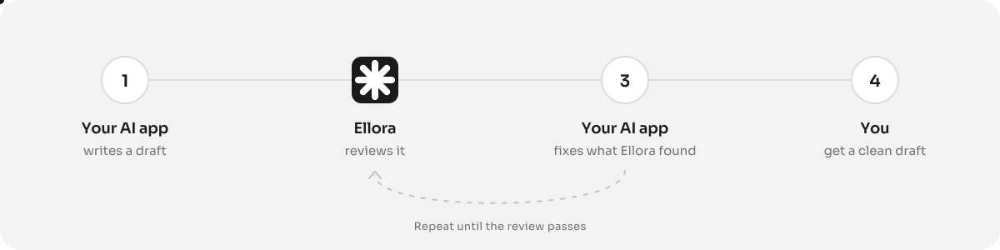

<a href="https://getellora.com">
  <picture>
    <source media="(prefers-color-scheme: dark)" srcset="assets/readme/hero-dark.svg">
    
  </picture>
</a>

<p align="center">
  <a href="https://getellora.com">Website</a> &nbsp;·&nbsp;
  <a href="https://app.getellora.com/register">Create a free account</a> &nbsp;·&nbsp;
  <a href="https://getellora.com/privacy/">Privacy</a>
</p>

## What is Ellora?

Ellora checks writing before you publish it. It is an editor that works inside the AI app you already use.

Your AI app writes the draft. Ellora reviews it and tells your AI app what to fix. Your AI app makes the fixes and asks Ellora again. When the review passes, your AI app shows you the draft.

<picture>
  <source media="(prefers-color-scheme: dark)" srcset="assets/readme/how-it-works-dark.svg">
  
</picture>

Each review runs four checks:

<picture>
  <source media="(prefers-color-scheme: dark)" srcset="assets/readme/checks-dark.svg">
  
</picture>

## What are these agent skills?

A skill is a set of instructions that your AI app reads. These two skills teach your AI app to use Ellora.

| Skill | What it does |
|---|---|
| [`ellora`](skills/ellora/SKILL.md) | Connects your AI app to Ellora. Then it runs a review on every draft before your AI app shows the draft to you. |
| [`ellora-review`](skills/ellora-review/SKILL.md) | Gives the full review steps: pick a voice profile and a writing brief, review, fix, and review again. |

The skills are text files only. They run no code on your computer.

## How to use them

**1. Create a free account** at [app.getellora.com/register](https://app.getellora.com/register). You need only your email address.

**2. Add Ellora to your AI app.**

Claude Code:

```bash
claude plugin marketplace add getellora/agent-skills
claude plugin install ellora@getellora
```

Then run `/mcp` in Claude Code and sign in to the `ellora` server.

claude.ai, Claude Desktop and Cowork: open **Customize > Plugins > Add > Add marketplace**. Enter `getellora/agent-skills` and install **Ellora**. Then connect Ellora on the plugin's **Connectors** tab.

ChatGPT: install Ellora from the [ChatGPT plugin directory](https://chatgpt.com/plugins/plugin_asdk_app_6ad60044b6b88191b9aae935d686d193).

Any other app that supports MCP: add this server, then add the skills.

```json
{
  "mcpServers": {
    "ellora": {
      "type": "streamableHttp",
      "url": "https://api.getellora.com/v1/external/mcp"
    }
  }
}
```

```bash
npx skills add getellora/agent-skills
```

<details>
<summary>Steps for Cursor, VS Code, Codex, OpenCode, Gemini CLI, Cline and Grok</summary>

**Cursor.** Open this link, or add the JSON block above to `~/.cursor/mcp.json`:

`cursor://anysphere.cursor-deeplink/mcp/install?name=ellora&config=eyJ1cmwiOiJodHRwczovL2FwaS5nZXRlbGxvcmEuY29tL3YxL2V4dGVybmFsL21jcCJ9`

**VS Code.** Open this link, or run **MCP: Add Server** and select HTTP:

`vscode:mcp/install?%7B%22name%22%3A%22ellora%22%2C%22type%22%3A%22http%22%2C%22url%22%3A%22https%3A//api.getellora.com/v1/external/mcp%22%7D`

VS Code needs `"type": "http"` under a `servers` key, in `.vscode/mcp.json`:

```json
{
  "servers": {
    "ellora": {
      "type": "http",
      "url": "https://api.getellora.com/v1/external/mcp"
    }
  }
}
```

**Codex.**

```bash
codex mcp add ellora --url https://api.getellora.com/v1/external/mcp
codex mcp login ellora
```

**OpenCode.** Add this to `opencode.json` in your project, or to `~/.config/opencode/opencode.json` for all projects:

```json
{
  "$schema": "https://opencode.ai/config.json",
  "mcp": {
    "ellora": {
      "type": "remote",
      "url": "https://api.getellora.com/v1/external/mcp",
      "enabled": true
    }
  }
}
```

Then run `opencode mcp auth ellora` and `npx skills add getellora/agent-skills -a opencode`.

**Gemini CLI.**

```bash
gemini mcp add --transport http ellora https://api.getellora.com/v1/external/mcp
```

Then run `/mcp auth ellora` in Gemini CLI.

**Cline.** Use the JSON block above. Cline needs `streamableHttp`, not `http`. On first connect, select **Authenticate**.

**Grok.** Grok Build reads Claude Code marketplaces, so the Claude Code commands work. On grok.com, open https://grok.com/connectors, select **New Connector > Custom**, and enter the server URL.

**Skills by hand.** `npx skills add` finds every supported agent on your computer. Add `-g` to install for your user, or `--skill ellora` for one skill only. To copy by hand, put `skills/ellora` in `.agents/skills/`, `.claude/skills/`, `.windsurf/skills/` or `.grok/skills/`.

**From a URL.** Tell your agent: `set up https://getellora.com/SKILL.md`.

</details>

**3. Sign in.** The first time your AI app uses Ellora, a browser window opens. Sign in and approve the connection. You do not need an API key.

**4. Write as usual.** Ask your AI app for a draft. It reviews the draft with Ellora before it shows the draft to you.

## Your data

Your AI app sends the draft text to `api.getellora.com` over HTTPS. Ellora keeps each draft and its review in your workspace, so you can see them in the app. A passing review can also update the voice profile it used. The skills and the plugin connect to no other server. Read the [privacy policy](https://getellora.com/privacy/) and the [terms](https://getellora.com/terms/).

## Try Ellora

<a href="https://app.getellora.com/register">
  <picture>
    <source media="(prefers-color-scheme: dark)" srcset="assets/readme/try-free-dark.svg">
    
  </picture>
</a>

<p align="center">Questions? Write to <a href="mailto:hello@getellora.com">hello@getellora.com</a>.</p>

## License

MIT. See [LICENSE](LICENSE).
